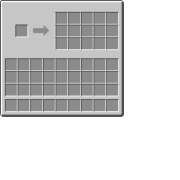

# CopyBox

A simple Minecraft mod that adds a copybox block to the game.

## Setup

For setup instructions, please see the [Fabric Documentation page](https://docs.fabricmc.net/develop/getting-started/creating-a-project#setting-up) related to the IDE that you are using.

## License

This mod is available under the MIT license. Feel free to learn from it and incorporate it in your own projects.
